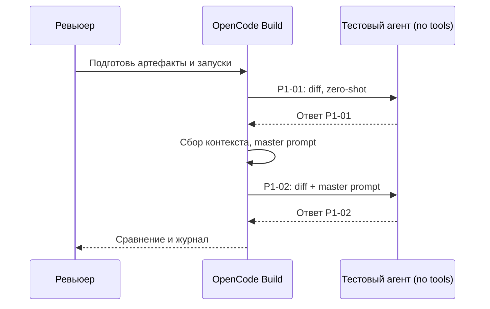

# ADR: Структура помощника ревью PR

Решение: использовать master prompt с Context Pack для анализа diff и генерации проверяемых выводов. Архитектурно разделить рабочий агент (Build) и тестовые запуски без инструментов.

## Архитектурная схема

## Как использовали AI

Тип: фиксация архитектуры. См. prompts.md (P1-setup).
