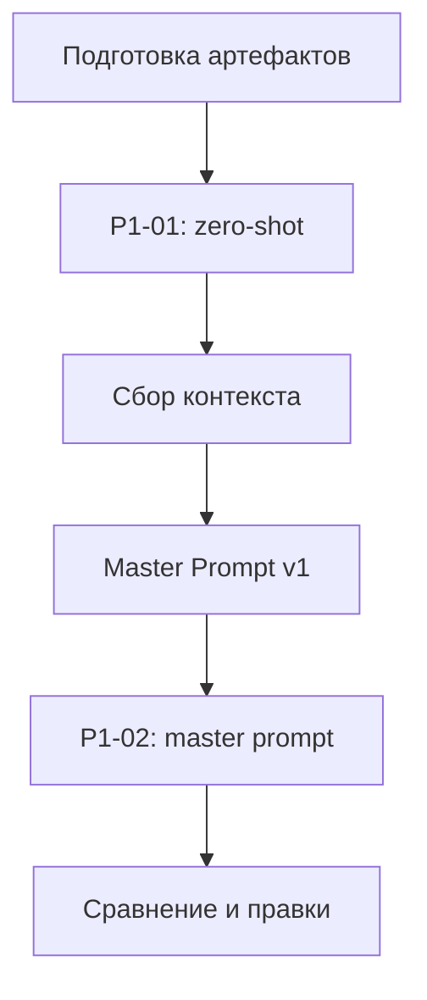

# План поставки

Роли: студент — заказчик и ревьюер; OpenCode Build — исполнитель; тестовая модель — помощник без инструментов.

Инкременты: P1-01, мастер-промпт, P1-02, сравнение.

## Как использовали AI

Тип: планирование поставки. См. prompts.md (P1-setup).
